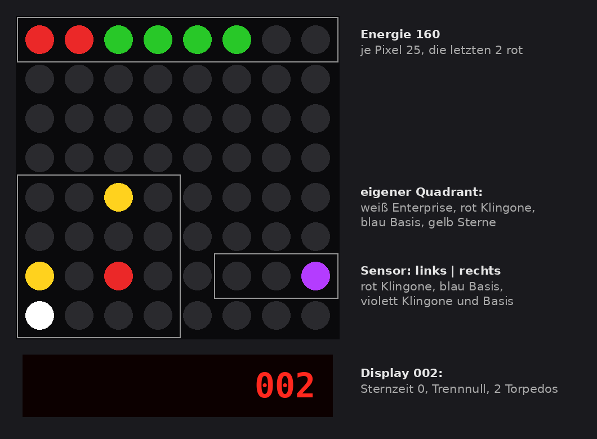

# StarTrek2090

Star Trek im Stil von 1971 für den Busch Microtronic 2090 mit dem [ESP2090 Studio](https://github.com/rab-berlin/ESP2090) (8x8-LED-Matrix mit Farben): 8 Klingonen in einer Galaxie aus 16 Quadranten finden und zerstören, bevor Energie oder Zeit ausgehen.

- 255 von 256 Programmschritten belegt
- Dateien: [startrek.mic](startrek.mic), das kommentierte Listing, und das Userscript [startrek_farben.py](startrek_farben.py) für die Farben
- Getestet im [Emulator2090](https://github.com/rab-berlin/Emulator2090) und mit einer Simulation aller 256 Galaxien ([simulation](simulation)), noch nicht am Gerät



## Spiel

Die Galaxie hat 4 x 4 Quadranten zu je 4 x 4 Sektoren und ist ringförmig geschlossen: Wer rechts hinausfliegt, kommt links wieder herein, ebenso oben und unten. Die Matrix zeigt immer nur den Quadranten, in dem die Enterprise gerade steht.

- **Klingonen:** 8, höchstens einer je Quadrant. Sie bewegen sich nicht. Steht die Enterprise in einem Quadranten mit Klingone, schießt er nach jeder Aktion: 0 bis 30 Energie.
- **Basis:** genau eine, irgendwo in der Galaxie. Wer hineinfliegt, dockt an: wieder 200 Energie und 2 Torpedos. Die Enterprise bleibt vor der Basis stehen. Am Anfang hat sie ebenfalls 200 Energie und 2 Torpedos.
- **Sterne:** 2 je Quadrant. Sie halten Flug und Phaser auf.
- **Gewonnen:** alle 8 Klingonen zerstört, das Programm hält an Adresse A2.
- **Verloren:** Energie unter 0 oder nach 51 Aktionen die Zeit abgelaufen, das Programm hält an Adresse A3.

Jede Aktion zählt die Sternzeit weiter, auch Sensor und Andocken. Danach schießt ein Klingone im Quadranten, dann zeichnet die Matrix neu (etwa 3,5 Sekunden).

## Befehle

Jeder Zug beginnt mit einer Taste am Microtronic.

| Taste | Befehl | danach | Kosten | Wirkung |
|---|---|---|---|---|
| 0 | Navigation | Richtung, Entfernung 1-F | 3 Energie je Feld | fliegt Feld für Feld, hält vor Stern oder Klingone; in eine Basis = andocken |
| 1 | Sensor | – | 16 Energie | zeigt die Nachbarquadranten links und rechts in derselben Galaxiezeile, bis zur nächsten Aktion |
| 2 | Phaser | Richtung, Energie 1-F | 16 Energie je Stufe | der Strahl fliegt so viele Felder weit und trifft das erste Objekt; ein Klingone ist zerstört |
| 3-F | Torpedo | – | 1 Torpedo | zerstört den Klingonen im eigenen Quadranten sicher; ohne Ziel oder Torpedo geschieht nichts |

Richtungen wie auf dem Tastenfeld:

```
8 9 A
4 5 6
0 1 2
```

0 als Entfernung oder Phaser-Energie bricht den Befehl ab, ohne dass Zeit vergeht. Richtung und Entfernung werden nicht angezeigt; erst das neue Bild zeigt, was geschehen ist. Ein Phaser mit F kostet 240 Energie und ist meist das Ende.

## Anzeige

| Wo | Was |
|---|---|
| Matrix, Zeile 7 | Energiebalken, je 25 Energie ein Pixel (8 Pixel = 200). Grün, die letzten beiden rot (unter 50) |
| Matrix, unten links 4 x 4 | der eigene Quadrant: weiß Enterprise, rot Klingone, blau Basis, gelb Sterne |
| Matrix, Zeile 1, Spalten 5 und 7 | Sensor: Nachbarquadrant links und rechts, rot Klingone, blau Basis, violett beides, sonst dunkel. Spalte 6 dazwischen ist der eigene Quadrant |
| Anzeige des Microtronic | beim Warten auf eine Taste drei Ziffern: Sternzeit 0-F, eine trennende 0, Torpedos. `502` heißt Sternzeit 5, 2 Torpedos. Die Sternzeit rückt alle 3 bis 4 Aktionen eins weiter. Nach F läuft die Zeit ab |

Die Anzeige ist dunkel, solange die Matrix zeichnet: Mit eingeschalteter Anzeige braucht jeder Befehl 20,5 statt 9,3 ms, und dann schafft die Matrix den Handshake nicht.

## Start

1. Matrix einschalten („LED on“ in der Weboberfläche). Sie muss beim Start wach sein.
2. Das Userscript `startrek_farben.py` mit **Run** starten. Es setzt die Farben und endet sofort.
3. RESET, `HALT` `NEXT` `00` `RUN`.

Die Zeit zwischen RESET und RUN bestimmt die Galaxie. Neues Spiel: RESET, RUN.

**Ohne Userscript** färbt das Programm Karte und Sensor selbst, nur der Energiebalken bleibt in der Standardfarbe der Matrix.

## Spieltipps

- Die Enterprise startet in der linken unteren Ecke der Galaxie. Ein Sensor-Scan je Galaxiezeile spart viel Suchen.
- Die Klingonen-Reihen der Galaxie sind nicht unabhängig: Von zwei Quadranten derselben Spalte, zwei Galaxiezeilen auseinander, hat genau einer einen Klingonen.
- Die Basis zuerst suchen. Wer sie kennt, kann rechtzeitig tanken; wer sie erst mit leerem Balken sucht, kommt meist nicht mehr an.
- Umwege kosten mehr Energie als alles andere. Lieber früh tanken, beim fünften Pixel, als spät.
- Der Torpedo ist sicher und kostet keine Energie; jede Basis füllt ihn wieder auf.

## Einstellen

Alle Werte sind Konstanten im Programm und lassen sich ohne zusätzliche Schritte ändern.

| Was | Adresse | Befehl | Bedeutung |
|---|---|---|---|
| Torpedos bei Start und Andocken | 0F | `12C` (`MOVI 2,C`) | `11C` = 1, `13C` = 3 Torpedos |
| Zeitlimit | 13 | `55A` (`ADDI 5,A`) | je Aktion + 5, Ende nach 52 Zählungen (51 Aktionen). `54A` = 63, `56A` = 42 Aktionen |
| Energie beim Andocken | 0D, 0E | `188`, `1C9` | C8h = 200 |
| Sensor | 78 | `719` (`SUBI 1,9`) | 1 x 16 Energie |
| Navigation | AB | `13D` (`MOVI 3,D`) | 3 Energie je Feld |

## Simulation

Im Ordner [simulation](simulation) liegt ein Regelmodell des Programms in Python, Zug für Zug gegen den Emulator geprüft, dazu Spielerstrategien. Die Spieler sehen nur, was auch ein Mensch sieht: den eigenen Quadranten, das Sensorbild, den Energiebalken in 25er-Stufen, Torpedos und Sternzeit. `python3 run_sim.py 1` spielt jede Strategie in allen 256 Galaxien (einige Sekunden je Strategie); alle Ergebnisse stehen in [sim_ergebnisse.txt](simulation/sim_ergebnisse.txt).

| Strategie | Siege | verloren durch Energie / Zeit |
|---|---|---|
| zufällige Tasten | 0 % | 100 % / 0 % |
| suchen ohne Sensor | 43 % | 45 % / 12 % |
| Sensor je Zeile, tankt erst beim letzten Pixel | 52 % | 48 % / 0 % |
| Sensor je Zeile, Torpedo statt Umweg | 67 % | 33 % / 0 % |
| Sensor je Zeile, sucht zuerst die Basis, tankt beim fünften Pixel | 84 % | 16 % / 0 % |
| dazu Torpedo zuerst und die Regel der Klingonen-Reihen | 84 % | 16 % / 0 % |
| kennt die ganze Galaxie (obere Grenze) | 99,6 % | 0,4 % / 0 % |

Die Werte stammen aus dieser Simulation: eine Basis, 2 Torpedos, 51 Aktionen. Mit zwei Basen und 3 Torpedos gewannen sorgfältige Spieler 96 bis 99 %. Mit nur einer Basis war die Basis neben einem Klingonen im Sensor zunächst unsichtbar, und die meisten Partien endeten mit leerem Tank; deshalb zeigt der Sensor „Klingone und Basis“ in einer eigenen Farbe. Die Startaufstellung macht kaum einen Unterschied.

## Wie es gemacht ist

Der 2090 kennt keine indirekte Adressierung und nur eine Rücksprungadresse. 256 Felder Galaxie kann er also weder speichern noch durchsuchen. Deshalb wird die Galaxie bei Bedarf berechnet.

- **Galaxie aus zwei Ziffern.** `RND` am Anfang liest den Zähler, der seit RESET läuft. Aus seinen Ziffern D und E entstehen die Klingonen-Reihen D, E, nicht D, nicht E (je ein Bit je Quadrant, zusammen immer 8 Klingonen) und zwei Startwerte, aus denen sich für jeden Quadranten die Sektoren von Klingone, Basis und Sternen ergeben. Die Basis liegt im Quadranten mit der Nummer E. Es gibt 256 verschiedene Galaxien.
- **Sensorfarbe gerechnet.** Die Farbe des Sensorpixels ist 8 bei einer Basis, sonst 0; ein Klingone addiert 3. So entstehen rot (3), blau (8) und violett (11) ohne zusätzlichen Befehl.
- **Ein Unterprogramm für alles.** `LQ` (69 Schritte) berechnet zu einem beliebigen Feld den Quadranten und liefert, was auf dem Feld liegt. Flug, Phaser, Sensor und Bild benutzen es alle.
- **Reihen drehen statt adressieren.** Die vier Klingonen-Reihen liegen in M0-M3. Um Reihe y zu lesen, dreht das Programm die vier Register, bis sie in M0 liegt, und merkt sich den Drehstand.
- **Energie als Linie.** Der Balken ist ein einziger Linienbefehl der Matrix bis zum Pixel Energie / 25. Die Farben der Zeile setzt das Userscript; das Programm schaltet die Pixel nur an und aus.
- **Display mit Trennnull.** Vor dem Warten auf die Taste kopiert das Programm Sternzeit, 0 und Torpedos in drei benachbarte Register, die `DISP` dann zeigt.
- **Keine verschachtelten Aufrufe.** Das Löschen der Matrix läuft direkt in die Routine für Matrixbefehle hinein, statt sie aufzurufen.

## Geschichte

*Star Trek* schrieb Mike Mayfield 1971 in BASIC: eine Galaxie aus 8 x 8 Quadranten zu je 8 x 8 Sektoren, Klingonen, Sternenbasen, Phaser, Torpedos, Langstreckensensor und eine Sternzeit, bis zu der alle Klingonen zerstört sein müssen. Das Spiel wurde auf vielen Rechnern nachgebaut und gehört zu den bekanntesten Computerspielen der 70er Jahre. Auf dem Microtronic ist die Galaxie auf 4 x 4 x 4 x 4 geschrumpft, und statt eines Bildschirms zeigen 64 LEDs den Quadranten.
